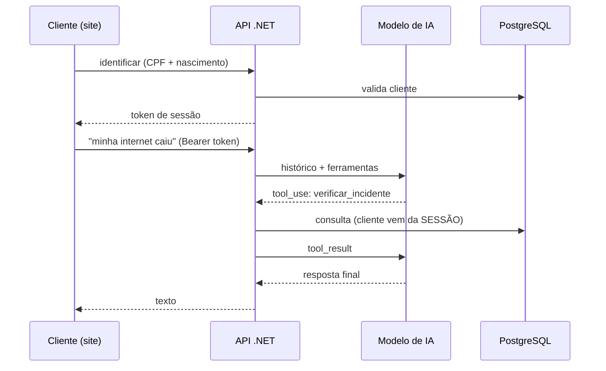

# Suporte Provedor — API

API em .NET 10 de um **agente de suporte com IA para provedores de internet pequenos**. O cliente abre o chat pelo site
(o WhatsApp serve só de porta de entrada, com uma resposta automática contendo o link), se identifica e conversa com um
agente que consulta os sistemas do provedor por **ferramentas (tool use)**: segunda via, diagnóstico da conexão,
desbloqueio em confiança, paliativos e abertura de chamado para visita técnica.

> Projeto de portfólio. Os sistemas do provedor (ERP, Radius/ACS/OLT, NOC) são **simulados** por tabelas no PostgreSQL;
> todos os dados são fictícios. Front-end: [suporte-provedor-site](https://github.com/Marestoni/suporte-provedor-site).

## O que ele faz



### Ferramentas do agente
`listar_faturas` · `segunda_via` · `status_conexao` · `verificar_incidente` · `desbloqueio_confianca` ·
`abrir_chamado` · `transferir_humano`

O roteiro de atendimento (checar incidente na região → status da ONU → paliativos → visita técnica) fica no
system prompt: [`Prompts.cs`](src/SuporteProvedor.Api/Application/Agent/Prompts.cs).

## Decisões de design

- **Identidade vem da sessão, nunca do modelo.** As ferramentas recebem o `cliente_id` do contexto autenticado;
  o modelo não escolhe de quem são os dados, então não há como "pedir a fatura de outro CPF".
- **Regras de negócio no código, não no prompt.** O modelo apenas *pede* o desbloqueio em confiança; o código decide
  (1 por mês, até 3 dias, só se bloqueado por inadimplência). [`RegrasDesbloqueio`](src/SuporteProvedor.Api/Domain/RegrasDesbloqueio.cs) tem testes unitários.
- **Provedor de IA plugável** atrás de `IAgentModel`: OpenRouter (padrão), Anthropic direto (HTTP) ou um modelo
  roteirizado (`fake`) para desenvolvimento/testes sem chave.
- **Auditoria completa:** cada chamada de ferramenta e cada turno ficam em `mensagens.payload` (jsonb).
- **Dados mínimos ao modelo:** só primeiro nome, plano e situação da conexão. CPF e data de nascimento nunca saem do banco.

## Segurança

- Identificação por CPF + data de nascimento com erro **genérico** (não revela se o CPF existe). Limite em janela de 15 min
  por (CPF, IP) = 5, por IP = 60 (alto de propósito: CGNAT) e por CPF = 30, mais 3 por conversa; criar conversas novas não zera o contador (impede força
  bruta da data de nascimento; IPv6 agrupado em /64) e um terceiro não consegue travar o dono do CPF a partir de um único IP.
- Uma requisição por vez por conversa (429 se houver outra em andamento; 409 = atendimento encerrado) e histórico saneado antes de ir ao modelo
  (sem turnos vazios nem `tool_use` sem resultado), limitado às últimas 40 mensagens.
- Atrás de proxy, configure `Proxy:ProxiesConhecidos` (IPs ou CIDR do proxy) para o limite por IP usar o IP real sem aceitar
  `X-Forwarded-For` forjado. `Proxy:ConfiarEmQualquerOrigem` existe, mas só é seguro se a API for inalcançável sem o proxy.
- CPF nas tentativas de identificação guardado como **HMAC-SHA256** com segredo do servidor (`Seguranca:ChaveHashCpf`).
- Retenção automática: tentativas com mais de 1 dia e conversas nunca identificadas são apagadas de hora em hora.
- Erros no formato **ProblemDetails** (RFC 7807); datas mostradas ao cliente em horário de Brasília.
- Token de sessão aleatório de 256 bits; só o **SHA-256** é salvo; comparação em tempo constante.
- Rate limit por IP, CORS restrito à origem do site, `Cache-Control: no-store`, `X-Content-Type-Options: nosniff`.
- Limite de tamanho de mensagem e de iterações do loop do agente.
- **Nenhum segredo no repositório.** Connection string e chaves vêm de `dotnet user-secrets`, variáveis de ambiente
  ou do `appsettings.Local.json` (ignorado pelo git).

## Estrutura

```
src/SuporteProvedor.Api/
  Api/             rotas e DTOs (ConversasEndpoints)
  Application/     AgentService (loop de tool use), SessaoService, Agent/ (ferramentas, prompt, modelos)
  Domain/          records e regras puras
  Infrastructure/  Db.cs (Npgsql + Dapper)
tests/             xUnit (regras do desbloqueio, adaptador do OpenRouter)
db/                scripts SQL numerados (schema + seed)
docs/DATABASE.md   modelo de dados, diagrama ER e decisões
```

Detalhes do banco, diagrama ER e "migrations": [docs/DATABASE.md](docs/DATABASE.md).

## API

| Método | Rota | Descrição |
|---|---|---|
| `POST` | `/api/conversas` | cria conversa → `{id}` |
| `POST` | `/api/conversas/{id}/identificar` | `{cpf, dataNascimento}` → `{token, nome, situacao}` |
| `POST` | `/api/conversas/{id}/mensagens` | `{texto}` (Bearer) → `{resposta, status, protocolo}` |
| `GET` | `/api/conversas/{id}/mensagens` | histórico visível (Bearer) |
| `GET` | `/health` | verificação de saúde |

## Como rodar

Requisitos: .NET 10 SDK e PostgreSQL.

```bash
# 1. banco
psql -U postgres -c "CREATE DATABASE suporte_provedor ENCODING 'UTF8'"
for f in db/*.sql; do psql -U postgres -d suporte_provedor -v ON_ERROR_STOP=1 -f "$f"; done   # 001 schema, 002 seed, 003 e 004 migrations

# 2. segredos locais (nunca commitar)
cd src/SuporteProvedor.Api
dotnet user-secrets set "ConnectionStrings:Default" "Host=localhost;Database=suporte_provedor;Username=postgres;Password=<sua-senha>"
dotnet user-secrets set "OpenRouter:ApiKey" "<sua-chave>"        # ou use Agent:Provider=fake

# 3. executar (http://localhost:5180)
ASPNETCORE_ENVIRONMENT=Development ASPNETCORE_URLS=http://localhost:5180 dotnet run --no-launch-profile
```

Sem chave de IA, use o modelo roteirizado: `dotnet user-secrets set "Agent:Provider" "fake"`.
Alternativa aos user-secrets: um `appsettings.Local.json` na pasta do projeto (já no `.gitignore`).

Clientes de teste (fictícios), um cenário cada:

| Cliente | CPF | Nascimento | Cenário |
|---|---|---|---|
| Ana Souza | 11144477735 | 1990-03-15 | tudo ok, segunda via |
| Bruno Lima | 52998224725 | 1985-07-22 | bloqueado por inadimplência |
| Carla Dias | 39053344705 | 1992-11-02 | online com sinal óptico ruim |
| Diego Rocha | 11122233396 | 1978-01-30 | offline, queda geral no bairro |

Testes: `dotnet test` roda os testes unitários. Os de **integração** (desbloqueio atômico, chamado idempotente, loop do agente com modelo
roteirizado) usam um PostgreSQL real e criam/apagam um banco temporário; para habilitá-los defina uma connection string administrativa:

```bash
export SUPORTE_TEST_PG="Host=localhost;Username=postgres;Password=<sua-senha>;Database=postgres"
dotnet test
```

Sem a variável eles são pulados.

## Roadmap

- Integração com ERP real (IXC / MK-Auth / SGP / Voalle) por adapters, e Radius/ACS para diagnóstico
- Reboot remoto de ONU (TR-069 / GenieACS)
- Streaming (SSE) das respostas
- *Walled garden*: manter o domínio do chat liberado para clientes bloqueados (Mikrotik/Radius)
- Painel para atendentes (conversas `transferida_humano`)

## Licença

[MIT](LICENSE) © 2026 André Marestoni
