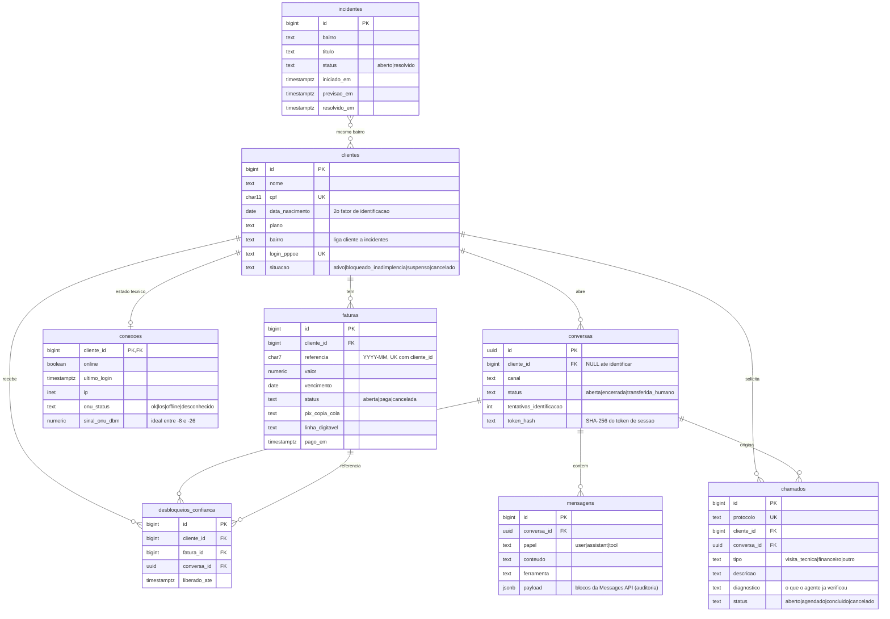

# Banco de dados

PostgreSQL 16+ (testado no 18). Banco: `suporte_provedor`. Abordagem **MVP, SQL-first**: o schema é versionado como scripts
SQL numerados em [`db/`](../db) e acessado com Npgsql + Dapper (sem ORM).

## Migrations (documentação)

Não há ferramenta de migration automática no MVP. Os scripts em `db/` **são** o histórico, aplicados em ordem:

| Script | Conteúdo |
|---|---|
| `db/001_schema.sql` | Cria as 8 tabelas, constraints e índices. Idempotente (`IF NOT EXISTS`). |
| `db/002_seed.sql` | Dados **fictícios** de desenvolvimento (4 clientes, um cenário de teste cada). Idempotente (`ON CONFLICT DO NOTHING`). |

Alterações futuras entram como novos arquivos (`003_...sql`, `004_...sql`), nunca editando um script já aplicado em outro ambiente.
Quando o projeto crescer, os mesmos arquivos migram para uma ferramenta (DbUp, Flyway ou EF Core Migrations) sem mudar o schema.

Criar do zero (defina `PGPASSWORD` ou use o `.pgpass`):

```bash
psql -U postgres -h localhost -c "CREATE DATABASE suporte_provedor ENCODING 'UTF8'"
psql -U postgres -h localhost -d suporte_provedor -f db/001_schema.sql -f db/002_seed.sql
```

## Modelo

As tabelas se dividem em dois grupos:

- **Simulam os sistemas do provedor** (`clientes`, `faturas`, `conexoes`, `incidentes`): no MVP fazem o papel de ERP,
  Radius/ACS/OLT e NOC. Na integração real são substituídas por adapters; o restante do modelo não muda.
- **Pertencem ao agente** (`conversas`, `mensagens`, `chamados`, `desbloqueios_confianca`): permanentes.



## Tabelas

### `clientes` (simula ERP)
Cadastro do assinante. `cpf` + `data_nascimento` formam a identificação no chat. `situacao` controla o fluxo de
inadimplência. `bairro` é a chave que liga o cliente a falhas gerais em `incidentes`.

### `faturas` (simula ERP)
Uma por cliente/mês (`UNIQUE (cliente_id, referencia)`). `pix_copia_cola` e `linha_digitavel` alimentam a ferramenta de
segunda via. Índice `(cliente_id, status)` para listar faturas em aberto.

### `conexoes` (simula Radius/ACS/OLT)
Uma linha por cliente com o estado técnico: sessão online, último login, IP e status/sinal óptico da ONU.
Sinal pior que -27 dBm indica problema físico (fibra/conector) e leva à visita técnica.

### `incidentes` (simula NOC)
Falhas gerais por bairro. Índice `(bairro, status)`. Se há incidente aberto no bairro, o agente informa a previsão
e **não** abre chamado.

### `conversas`
Uma por atendimento. Nasce anônima (`cliente_id` nulo) e é vinculada ao cliente ao identificar. Guarda só o
**hash** do token de sessão (`token_hash`), nunca o token. `tentativas_identificacao` limita a 3 tentativas.

### `mensagens`
Histórico completo e auditoria. `payload` (jsonb) guarda os blocos da Messages API (texto, `tool_use`, `tool_result`),
o que permite reconstruir o contexto do modelo a cada turno. Índice `(conversa_id, id)`.

### `chamados`
Saída da ferramenta `abrir_chamado`. `diagnostico` registra o que o agente já verificou e tentou, para o técnico
não repetir o roteiro. `protocolo` é único (formato `CH-yyMMdd-NNNN`).

### `desbloqueios_confianca`
Histórico do desbloqueio temporário. A regra (1 por mês, até 3 dias, só para `bloqueado_inadimplencia`) é aplicada
**em código** (`RegrasDesbloqueio`, com testes), não no banco nem no prompt; a tabela é a evidência para a regra de 30 dias.

## Decisões

- **IDs:** `bigint identity` nas tabelas de negócio; `uuid` em `conversas` (o id aparece em URLs públicas e não deve ser adivinhável/sequencial).
- **Datas:** `timestamptz` (UTC); lidas como `DateTime` UTC no C#.
- **Domínios:** `CHECK` em vez de `ENUM` do Postgres (mais simples de evoluir em scripts).
- **Dados sensíveis:** CPF e data de nascimento ficam só em `clientes`; nunca são enviados ao modelo (só o primeiro nome, o plano e a situação).
